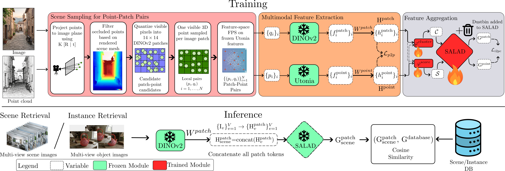

<div align="center">

# CrossWeave: Cross-Modal Scene and Instance Retrieval from Sparse 2D-3D Alignment

**NeurIPS 2026**

Aadith Warrier<sup>1</sup>, Gnana Prakash Punnavajhala<sup>1</sup>, Siddharth Tourani<sup>2</sup>,
Muhammad Haris Khan<sup>3</sup>, Avinash Sharma<sup>4</sup>, Madhava Krishna<sup>1</sup>

<sup>1</sup>IIIT Hyderabad, India &nbsp; <sup>2</sup>University of Heidelberg, Germany &nbsp; <sup>3</sup>MBZUAI, UAE &nbsp; <sup>4</sup>IIT Bombay, India

Paper (coming soon) · arXiv (coming soon) · [Project page](https://crossweave3d.github.io) · [Checkpoints](https://huggingface.co/aadith-warrier/crossweave)



</div>


## Contents

- [Installation](#-installation)
- [Data preparation](#-data-preparation)
- [Pretrained models](#-pretrained-models)
- [Evaluation](#-evaluation)
- [Training](#-training)
- [Results](#-results)
- [Repository structure](#-repository-structure)
- [License and acknowledgements](#-license-and-acknowledgements)
- [Citation](#-citation)

## 🔧 Installation

Requirements: Linux x86-64, an NVIDIA GPU with CUDA 12.8 drivers, and [pixi](https://pixi.sh).
Preprocessing renders depth and masks headlessly with EGL and requires working OpenGL/EGL drivers.

```bash
git clone --recursive https://github.com/crossweave3d/crossweave.git
cd crossweave
pixi install            # Python 3.10, PyTorch 2.8 (cu128), flash-attn, spconv, torch-scatter/-cluster
```

For a clone made without `--recursive`, run `git submodule update --init` to fetch [Utonia](https://github.com/Pointcept/Utonia) into `libs/Utonia`.

Pretrained weights required for training/inference:

| Model | Location | Notes |
|---|---|---|
| DINOv2 ViT-L/14 | `$TORCH_HOME/hub` | `torch.hub`, pinned to commit `7764ea0` |
| Utonia | `~/.cache/utonia/ckpt/utonia.pth` | Downloaded from Hugging Face (`Pointcept/Utonia`) if missing |
| TIPSv2 ViT-L/14 (optional) | `~/.cache/tips/tips_v2_oss_l14_vision.npz` | Manual [download](https://storage.googleapis.com/tips_data/v2_0/checkpoints/pytorch/tips_v2_oss_l14_vision.npz) |

## 📦 Data preparation

CrossWeave uses [ScanNet v2](http://www.scan-net.org/) and [3RScan](https://waldjohannau.github.io/RIO/).

```bash
python -m crossweave.data.preprocess unpack --dataset scannet --root $SCANNET
python -m crossweave.data.preprocess encode --dataset scannet --root $SCANNET --cache_dir $CACHE/scannet
python -m crossweave.data.preprocess frames --dataset scannet --root $SCANNET --cache_dir $CACHE/scannet --split train
python -m crossweave.data.preprocess eval   --dataset scannet --root $SCANNET --cache_dir $CACHE/scannet
```

Repeat the four commands for 3RScan with `--dataset threerscan --root $THREERSCAN --cache_dir $CACHE/3rscan`.
Run each command with `pixi run` or inside `pixi shell`.
The cache requires about 755 GB for ScanNet and 260 GB for 3RScan. [docs/DATA.md](docs/DATA.md) describes the
expected directory layout, outputs, disk requirements, and sanity checks.

All commands below take the four data paths as overrides, abbreviated as `$DATA`:

```bash
DATA="data.scannet_root=$SCANNET data.scannet_cache=$CACHE/scannet \
      data.threerscan_root=$THREERSCAN data.threerscan_cache=$CACHE/3rscan"
```

## 🧠 Pretrained models

| Model | Image encoder | Scene R@1 ScanNet | Scene R@1 3RScan | Instance Top-1 ScanNet | Instance Top-1 3RScan | Download |
|---|---|---|---|---|---|---|
| CrossWeave | DINOv2 ViT-L/14 | 60.58 | 47.13 | 77.66 | 73.61 | [`crossweave_dinov2_vitl14.ckpt`](https://huggingface.co/aadith-warrier/crossweave/blob/main/crossweave_dinov2_vitl14.ckpt) |
| CrossWeave - TIPSv2 | TIPSv2 ViT-L/14 | 59.29 | 43.95 | 75.22 | 73.28 | [`crossweave_tipsv2_l14.ckpt`](https://huggingface.co/aadith-warrier/crossweave/blob/main/crossweave_tipsv2_l14.ckpt) |

All numbers are image → point cloud.
- **Scene R@1:** retrieval among all val scenes, 10 images per scene.
- **Instance Top-1:** each object's 10 most visible views matched to its point cloud among the objects of the same scene.

Checkpoints contain only the trained adapters and SALAD (14 MB). The frozen image encoder and Utonia weights are
loaded according to the checkpoint's `image_encoder` setting.

## 📊 Evaluation

```bash
pixi run python -m crossweave.evaluate --ckpt path/to/model.ckpt $DATA
```

The script runs scene retrieval on the ScanNet and 3RScan val scenes, followed by instance retrieval. It prints a
summary of the rgb → point results and writes all metrics (including rgb → rgb and point → point) to
`<ckpt>.eval.json`. `--scene-only` skips instance retrieval and overwrites the same JSON file.

Protocol:
- **Scene retrieval:** 10 images per scene, selected by farthest-point sampling over camera poses (20 samples, every second one kept), retrieved against all val scenes.
- **Instance retrieval:** each object's 10 most visible views. Objects with 50 or fewer vertices and the NYU40 classes unannotated, wall, floor, ceiling, and otherstructure are excluded. Metrics are Top-1/Top-3 within a scene and scene-level R@25/50/75%.

## 🚀 Training

```bash
pixi run python -m crossweave.train $DATA logging.root_dir=runs logging.base_exp_name=crossweave
```

`--config-name tipsv2_utonia` selects the TIPSv2 encoder. Each run writes to a separate directory with the following format.

```
runs/<run_id>/            # run_id = <base_exp_name>_<YYYYmmdd-HHMMSS>, or set logging.run_id
    config.yaml           # resolved config
    checkpoints/          # best_r1_<R@1>_epoch_<NN>.ckpt, last.ckpt
    csv/ or wandb/        # metrics (logging.use_wandb=true for Weights & Biases)
```

## 📈 Results

Image → point cloud, val split. Paper rows use DINOv2.

### Scene retrieval

| | ScanNet R@1 | R@5 | R@10 | 3RScan R@1 | R@5 | R@10 |
|---|---|---|---|---|---|---|
| Paper | 61.54 | 99.36 | 100.00 | 46.50 | 85.99 | 92.36 |
| Release - DINOv2 | 60.58 | 98.08 | 99.36 | 47.13 | 87.90 | 95.54 |
| Release - TIPSv2 | 59.29 | 98.08 | 99.68 | 43.95 | 81.53 | 93.63 |

### Instance retrieval

| | ScanNet Top-1 | Top-3 | R@25% | R@50% | R@75% | 3RScan Top-1 | Top-3 | R@25% | R@50% | R@75% |
|---|---|---|---|---|---|---|---|---|---|---|
| Paper | 78.77 | 94.05 | 98.40 | 88.78 | 67.95 | 73.50 | 92.73 | 98.09 | 92.99 | 49.68 |
| Release - DINOv2 | 77.66 | 93.48 | 99.04 | 89.10 | 67.31 | 73.61 | 93.46 | 98.09 | 91.08 | 52.23 |
| Release - TIPSv2 | 75.22 | 92.59 | 98.72 | 87.50 | 62.82 | 73.28 | 92.74 | 98.73 | 91.72 | 52.87 |

- **Top-1 / Top-3:** averaged over scenes; each object is matched among the objects of its own scene.
- **R@x%:** fraction of scenes in which at least x% of objects are matched correctly at Top-1.

**Differences from the paper code.** This release reimplements data preprocessing and fixes minor bugs in the original
pipeline. The fixes change the features seen by the model, so the release checkpoints were retrained and their numbers differ slightly from the paper. 

## 📁 Repository structure

```
src/crossweave/
    train.py, evaluate.py      # entry points
    config/                    # dinov2_utonia.yaml, tipsv2_utonia.yaml
    data/                      # dataset readers, preprocessing CLI, projection, Utonia encoding, rendering
    models/                    # CrossWeave LightningModule, image backbones, SALAD aggregator
    eval/                      # scene / instance feature extraction and retrieval metrics
libs/Utonia/                   # point encoder (submodule)
```

## 📜 License and acknowledgements

This code is released under the [GPL-3.0 license](LICENSE).

We thank the authors of the following works for releasing their code publicly:

- [SALAD](https://github.com/serizba/salad)
- [OpenGlue](https://github.com/ucuapps/OpenGlue)
- [DINOv2](https://github.com/facebookresearch/dinov2)
- [TIPS](https://github.com/google-deepmind/tips)
- [Utonia](https://github.com/Pointcept/Utonia)
- [ScanNet](https://github.com/ScanNet/ScanNet)
- [CrossOver](https://github.com/GradientSpaces/CrossOver)

## 📝 Citation

Coming Soon!